# Mushin

**A compact vision-language "System 1" that decides which skill a robot should run next, or whether it should not act at all.**

Mushin looks at the task, the robot's latest observation, its recent history and two camera frames, and answers in a single forward pass: a probability for every offered skill and for *abstain*, the probability that each skill would succeed right now, and the skill's parameters. It is built on Qwen3.5-0.8B and plugs into the planner slot of the [uzumaki](https://github.com/alokdidde/uzumaki) robot runtime.

| 🤗 Hugging Face | |
|---|---|
| **Model** | [alokdidde/mushin-0.8b-v0.1](https://huggingface.co/alokdidde/mushin-0.8b-v0.1): Qwen3.5-0.8B + LoRA + decision heads, with the model card and all benchmark files |
| **Training data** | [alokdidde/mushin-sim-decisions-v1](https://huggingface.co/datasets/alokdidde/mushin-sim-decisions-v1): 201k simulated robot decisions with counterfactual labels |
| **Next dataset** | [alokdidde/mushin-sim-decisions-v2](https://huggingface.co/datasets/alokdidde/mushin-sim-decisions-v2): v1 + 2,144 G1 episodes (206k decisions) |
| **G1 top-up** | [alokdidde/mushin-sim-decisions-g1-topup](https://huggingface.co/datasets/alokdidde/mushin-sim-decisions-g1-topup) |

> **v0.1 is a research release trained only in simulation.** The Hugging Face repos are private for now. See [Limitations](#limitations).

**Highlights**

- Picks the best skill more often than every baseline: **0.747** test accuracy vs 0.715, and **0.707** vs 0.632 on a robot body it never saw in training.
- Predicts whether each skill will succeed with **AUROC 0.916** and well-calibrated probabilities (ECE 0.005).
- Abstains when nothing can work, for example when the target is out of reach.
- As uzumaki's planner, matches the rule planner's task success (76.9% vs 78.1% over 480 paired sim episodes) with **17% fewer decisions**.
- **79 ms** per decision on an A40 GPU (bf16, 1.98 GB).

## What Mushin does

Robots in uzumaki act through a library of skills (pick a box, place it, walk somewhere, hand an object over). The skills do the motion. Something still has to decide, at every step, *which* skill to call, *with what parameters*, and *whether to call anything at all*. That is Mushin's job: it sits in uzumaki's planner slot (`DecisionSource`) in place of a hand-written rule selector or a slow LLM planner.

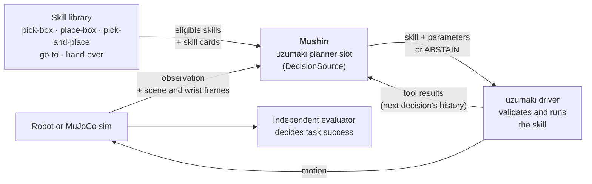

The driver still validates every decision, and an independent evaluator, not Mushin, decides whether the task succeeded.

## How it works

Each decision is one sequence through the model: the task, the observation, the last four steps, the two camera frames, every offered skill with its card, and an `abstain` option. Small typed heads read the hidden states at marked tokens instead of generating text.

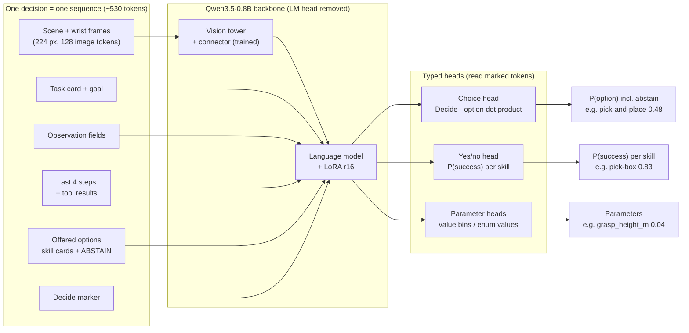

- **Choice:** a dot product between the `Decide` token and each option's last token, so any number of options in any order can be scored, and `abstain` is just another option.
- **Success:** a yes/no head gives P(success) for every offered skill.
- **Parameters:** a distribution over value bins for each numeric input and over the allowed values of each enum.
- **Calibration:** choice and success temperatures fitted on a held-out split are stored with the weights.

## Examples

Five real decisions from fresh simulator episodes (the M0 sample set, not used for training), run through the released model. "What actually happens" comes from replaying the episode with each option in turn, so it shows the true outcome of every choice, not just the one taken.

### 1. Start of a pick-and-place

| scene camera | wrist camera |
|:---:|:---:|
| 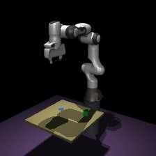 | 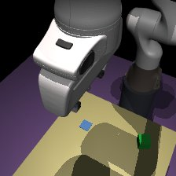 |

**Franka Panda**, `pick-place-v1`, decision 1. *Move the box to target_pose (x, y, yaw) on the tabletop and release it.*  
**Observation:** gripper open; target (0.12, -0.08) m.  
**History:** none (first decision).

| option | Mushin P(choice) | Mushin P(success) | what actually happens (simulated) |
|---|---:|---:|---|
| **`pick-and-place`** | 0.48 | 0.84 | completed ✅ |
| `pick-box` | 0.32 | 0.84 | completed ✅ |
| `place-box` | 0.14 | 0.73 | completed ✅ |
| `abstain` | 0.05 |  | abstained |

**Mushin's decision:** `pick-and-place` with `grasp_height_m = 0.0188`. **Best option (counterfactual label):** `pick-and-place`.

The box is on the table and nothing has happened yet. Mushin goes straight for the combined `pick-and-place` skill and picks a grasp height. The rule teacher would have called `pick-box` and then `place-box`, which also works but takes an extra decision.

### 2. Abstain when the target is out of reach (unseen robot)

| scene camera | wrist camera |
|:---:|:---:|
| 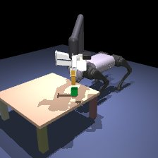 | 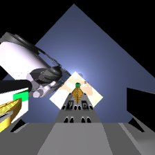 |

**Unitree Go1 (arm)**, `pick-place-v1`, decision 2. *Move the box to target_pose (x, y, yaw) on the tabletop and release it.*  
**Observation:** gripper open; target (0.43, 0.22) m.  
**History:** `pick-box` (misgrasp).

| option | Mushin P(choice) | Mushin P(success) | what actually happens (simulated) |
|---|---:|---:|---|
| **`abstain`** | 0.56 |  | abstained |
| `place-box` | 0.15 | 0.00 | unreachable target ❌ |
| `pick-and-place` | 0.15 | 0.00 | unreachable target ❌ |
| `pick-box` | 0.14 | 0.00 | unreachable target ❌ |

**Mushin's decision:** `abstain`. **Best option (counterfactual label):** `abstain`.

Go1 is a robot body Mushin never saw in training. Its first pick just failed, and the target pose (0.43 m, 0.22 m) is outside the arm's reach. Every skill would end in *unreachable target* or *budget exhausted*, so the right answer is to stop. Mushin abstains; the rule teacher would have tried `pick-box` again.

### 3. Hand-over between two arms

| scene camera | wrist camera |
|:---:|:---:|
| 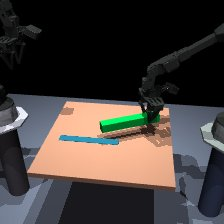 | 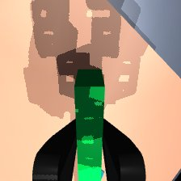 |

**ALOHA**, `handover-v1`, decision 4. *Move the object to target_pose (x, y, yaw) on the tabletop and release it; the giver cannot reach the target, so it must be handed over first.*  
**Observation:** gripper holding; holder giver; target (0.08, 0.04) m.  
**History:** `pick-box` (misgrasp) → `place-box` (not_held) → `pick-box` (ok).

| option | Mushin P(choice) | Mushin P(success) | what actually happens (simulated) |
|---|---:|---:|---|
| **`hand-over`** | 0.96 | 0.90 | completed ✅ |
| `abstain` | 0.03 |  | abstained |
| `pick-box` | 0.01 | 0.00 | budget exhausted ❌ |
| `place-box` | 0.01 | 0.00 | budget exhausted ❌ |

**Mushin's decision:** `hand-over`. **Best option (counterfactual label):** `hand-over`.

ALOHA's giver arm holds the object after a misgrasp, a rejected place and a successful re-pick. The target is on the receiver's side, so the object must be handed over first. Mushin is confident in `hand-over` (0.96) and knows that picking or placing now would fail.

### 4. Drive first when nothing is in reach

| scene camera | wrist camera |
|:---:|:---:|
| 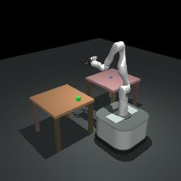 | 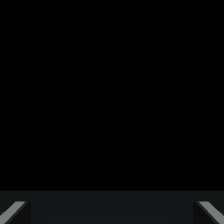 |

**TidyBot**, `fetch-v1`, decision 1. *Move the box to target_pose (x, y, yaw) on the other table and release it. Pick and place only what within_reach says is reachable; go to it first otherwise.*  
**Observation:** gripper open; target (0.80, 0.03) m; within_reach object=no, target=no.  
**History:** none (first decision).

| option | Mushin P(choice) | Mushin P(success) | what actually happens (simulated) |
|---|---:|---:|---|
| **`go-to`** | 0.91 | 0.78 | completed ✅ |
| `abstain` | 0.06 |  | abstained |
| `pick-box` | 0.02 | 0.00 | unreachable target ❌ |
| `place-box` | 0.02 | 0.00 | unreachable target ❌ |

**Mushin's decision:** `go-to` with `to = object`. **Best option (counterfactual label):** `go-to`.

TidyBot must fetch a box from another table. `within_reach` says neither the object nor the target can be reached, so the only useful move is to drive. Mushin picks `go-to` with the enum parameter `to = object`.

### 5. A miss: faults it cannot see

| scene camera | wrist camera |
|:---:|:---:|
| 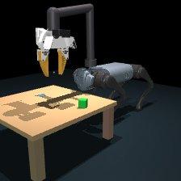 | 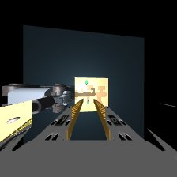 |

**Unitree Go1 (arm)**, `pick-place-v1`, decision 1. *Move the box to target_pose (x, y, yaw) on the tabletop and release it.*  
**Observation:** gripper open; target (0.12, -0.06) m.  
**History:** none (first decision).

| option | Mushin P(choice) | Mushin P(success) | what actually happens (simulated) |
|---|---:|---:|---|
| **`pick-and-place`** | 0.48 | 0.84 | budget exhausted ❌ |
| `pick-box` | 0.32 | 0.83 | budget exhausted ❌ |
| `place-box` | 0.15 | 0.73 | budget exhausted ❌ |
| `abstain` | 0.05 |  | abstained |

**Mushin's decision:** `pick-and-place` with `grasp_height_m = 0.0188`. **Best option (counterfactual label):** `abstain`.

This episode has three misgrasps injected, so every option eventually fails and the best answer would have been to abstain. Nothing in the first observation or frames shows that, and Mushin predicts the usual start (`pick-and-place`, P(success) 0.84). Faults that are invisible at decision time are a limit for any planner, and this kind of case is where the overconfident choice probabilities show.

## Results

All numbers are on held-out splits of [mushin-sim-decisions-v1](https://huggingface.co/datasets/alokdidde/mushin-sim-decisions-v1), after temperature calibration on a separate `calib` split. Choice accuracy is measured against the *counterfactual* best option (what actually works best when every option is tried in simulation), not against the teacher's action. `test_body` is the Go1 arm, a whole robot body held out of training. AURC is the area under the risk-coverage curve when the least confident decisions are deferred first.

| split | model | choice acc ↑ | choice Brier ↓ | AURC ↓ | success AUROC ↑ | success ECE ↓ |
|---|---|---:|---:|---:|---:|---:|
| val (n=8,771) | **Mushin 0.8B v0.1** | **0.756** | 0.448 | 0.153 | **0.916** | 0.005 |
| | frequency | 0.725 | **0.368** | **0.124** | 0.609 | 0.004 |
| | linear | 0.717 | 0.507 | 0.196 | 0.831 | 0.075 |
| | rule selector (data teacher) | 0.632 | 0.553 | 0.312 | 0.609 | 0.004 |
| test (n=8,997) | **Mushin 0.8B v0.1** | **0.747** | 0.456 | 0.166 | **0.916** | 0.005 |
| | frequency | 0.715 | **0.376** | **0.131** | 0.613 | 0.006 |
| | linear | 0.709 | 0.515 | 0.206 | 0.831 | 0.081 |
| | rule selector | 0.627 | 0.559 | 0.335 | 0.613 | 0.006 |
| test_body, Go1 (n=23,453) | **Mushin 0.8B v0.1** | **0.707** | 0.520 | **0.144** | **0.877** | 0.010 |
| | frequency | 0.632 | **0.464** | 0.208 | 0.538 | 0.096 |
| | linear | 0.630 | 0.620 | 0.215 | 0.716 | 0.063 |
| | rule selector | 0.442 | 0.745 | 0.554 | 0.538 | 0.096 |

The rule selector generated most of the training data but agrees with the counterfactual best option only about 63% of the time, so Mushin has learned to beat its own teacher. The head warm-up alone (backbone frozen) reached 0.708 choice accuracy and 0.833 success AUROC on val; LoRA adds the rest.

**Per body (test choice accuracy):** ALOHA 0.802, Go1 walking 0.802, TidyBot 0.791, Panda 0.706, Spot 0.704, SO-101 0.701, G1 0.665. G1 was under-represented in v1, which the v2 dataset fixes.

**Calibration:** fitted temperatures are 0.780 (choice) and 1.065 (success). P(success) is well calibrated (ECE 0.005 to 0.010). Choice ECE only goes from 0.184 to 0.158 on `calib` and stays at 0.16 on val/test and 0.20 on Go1, so the choice probabilities are overconfident.

### Closed loop

Whole uzumaki episodes on fresh seeds with random faults, 60 per body, run once with the rule planner and once with Mushin on exactly the same cases. uzumaki's evaluator decides success.

| body | rule success | Mushin success | decisions / episode, Mushin (rule) |
|---|---:|---:|---:|
| **all (480)** | **0.781** | **0.769** | **2.44 (2.95)** |
| SO-101 | 0.733 | 0.733 | 1.57 (2.42) |
| Panda | 0.750 | 0.750 | 1.57 (2.53) |
| Spot | 0.833 | 0.833 | 1.55 (2.40) |
| G1 | 0.800 | 0.767 | 1.50 (2.40) |
| Go1 (unseen body) | 0.850 | 0.850 | 1.55 (2.48) |
| ALOHA | 0.817 | 0.817 | 3.30 (3.30) |
| TidyBot | 0.683 | 0.633 | 4.17 (3.95) |
| Go1 walking | 0.783 | 0.767 | 4.30 (4.10) |

Paired: both succeed 368, neither 104, rule only 7, Mushin only 1. Most shared failures come from the injected faults (budget exhausted 55, unreachable target 22, cancellations, evaluation failures). On pick-and-place bodies Mushin goes straight to the combined `pick-and-place` skill when it is likely to work, so it needs about 1.55 decisions instead of 2.45. It abstains on the 22 unreachable targets where the rule planner tries and fails (both count as failures), and it had 3 more collisions (TidyBot) and 2 missing-observation stops.

### Latency

`python -m mushin.export.latency` on 50 real records, batch 1, about 532 tokens of which 128 are image tokens:

| device | forward median | forward p90 | preprocessing | peak memory |
|---|---:|---:|---:|---:|
| NVIDIA A40, bf16 | 79 ms | 108 ms | 11 ms | 1.98 GB |

This ran without `causal-conv1d` (its build failed against the pod's CUDA), so Qwen3.5's linear-attention layers used the slower PyTorch path. The Jetson Orin Nano target has not been measured yet. Inside the closed-loop simulator the median decision took 248 ms, but that includes rendering the camera frames.

Every result file (per-split and per-body metrics, calibration, latency, closed-loop episodes, training curve) is in the model repo's [`results/`](https://huggingface.co/alokdidde/mushin-0.8b-v0.1/tree/main/results).

### Limitations

- **Simulation only:** software-rendered MuJoCo frames and uzumaki's simulated skills. Mushin has never run on a real robot.
- **Overconfident choices:** don't use the choice probability as an abstention threshold without your own calibration check. The frequency baseline still has a better choice Brier score and risk-coverage curve.
- **Parity, not improvement, in closed loop:** the gains so far are fewer decisions and abstaining on unreachable targets, not higher task success.
- **Narrow scope:** three task protocols, a small skill library and one held-out body. Unseen tasks are untested.
- **Labels encode the simulator:** they are counterfactual outcomes under uzumaki's physics, with the rule selector finishing each episode.

## Quickstart

```bash
git clone https://github.com/alokdidde/mushin && cd mushin
uv venv -p 3.12 && uv pip install -e ".[train]"      # torch, transformers>=5.20, peft, safetensors
uv pip install -e ".[gpu]" causal-conv1d             # optional on CUDA: fast linear-attention kernels
hf auth login                                        # while the model repo is private
```

**Score a decision record**

```python
from pathlib import Path
import torch
from mushin.train import checkpoint
from mushin.train.data import load_dataset, make_example

model = checkpoint.load_pretrained("alokdidde/mushin-0.8b-v0.1", device="cuda")
data = Path("data/m4")                                   # a mushin.decision/1.0 dataset directory
records, cards = load_dataset(data, splits=["test"], limit=1)
example = make_example(records[0], cards, model.backbone, data)
with torch.inference_mode():
    pred = model(model.backbone.collate([example.encoded]), [example.layout])[0]
options = example.layout.option_ids
print(dict(zip(options, torch.softmax(pred.choice.float(), -1).tolist())))   # choice, incl. abstain
print(dict(zip(options, torch.sigmoid(pred.success.float()).tolist())))      # P(success) per skill
```

**Use it as uzumaki's planner**

```python
from mushin.train import checkpoint
from mushin.uzumaki_adapter import MushinPlanner

model = checkpoint.load_pretrained("alokdidde/mushin-0.8b-v0.1", device="cuda")
planner = MushinPlanner(model, skill_snapshot, task_card, protocol="pick-place-v1",
                        executable=executable_skill_ids, frames=frame_hook)
decision = planner.decide(decision_id, role, request)
# {"action": "select", "skill_id": "pick-and-place", "parameters": {...}, "mushin": {"confidence": ..., "p_success": {...}}}
# or {"action": "abstain", ...}
```

`load_pretrained` takes a Hub repo id or a local folder with `mushin_config.json` and `model.safetensors`, and builds the Qwen3.5-0.8B base from its own Hub repo. `python -m mushin.eval.closed_loop` shows a complete uzumaki wiring.

## Datasets

| Dataset | Decisions | Episodes | Use |
|---|---:|---:|---|
| [mushin-sim-decisions-v1](https://huggingface.co/datasets/alokdidde/mushin-sim-decisions-v1) | 201,078 | 75,667 | Training and evaluation data of mushin-0.8b-v0.1 |
| [mushin-sim-decisions-v2](https://huggingface.co/datasets/alokdidde/mushin-sim-decisions-v2) | 206,262 | 77,782 | v1 + 2,144 G1 episodes; v1 episodes keep their splits |
| [mushin-sim-decisions-g1-topup](https://huggingface.co/datasets/alokdidde/mushin-sim-decisions-g1-topup) | 5,184 | 2,144 | The G1 top-up on its own |

Each record (`mushin.decision/1.0`, [schema](mushin/schema/decision-1.0.schema.json)) is one decision taken during a MuJoCo episode:

- **8 bodies:** SO-101, Franka Panda, Spot, Unitree G1 and Unitree Go1 on `pick-place-v1`; ALOHA on `handover-v1`; TidyBot and the walking Go1 on `fetch-v1`.
- **Faults injected at random:** misgrasps, stale observations, dropped handovers, short drives, crashes, goal withdrawal and unreachable targets, so that abstaining is sometimes right (about 20% of targets are `abstain`).
- **Counterfactual labels:** every decision is replayed with each offered option in its place and the rule selector finishing the episode. That gives a success label per option, a hard and a soft choice target, and parameter targets. The simulator is deterministic, and replay checks reproduce the labels.
- **Frames:** 224 px scene and wrist JPEGs with render-only domain randomisation (lighting, colours, camera pose), about 2.9 GB.
- **Splits by episode (v1 decisions):** train 150,970, val 8,771, calib 8,887, test 8,997, and test_body (Go1) 23,453. All seeds use the `mushin-train-*` prefix and never overlap uzumaki's held-out evaluation sets.

```bash
hf download alokdidde/mushin-sim-decisions-v1 --repo-type dataset --local-dir data/m4
python -m mushin.data.finalize data/m4 --config configs/data_m0.yaml     # unpack the frames from shards/*/images.tar
```

## Training

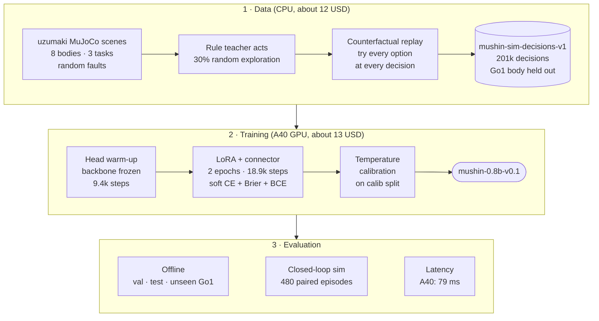

- **Recipe:** LoRA rank 16, alpha 32, dropout 0.05 on the attention, Gated DeltaNet and MLP projections, with the vision connector trained in full (24.4M trainable parameters). AdamW at 1e-4 (adapters) and 3e-4 (heads), effective batch 16, bf16.
- **Loss:** soft cross-entropy on the choice + 0.1 × Brier + BCE on per-option success + 0.5 × CE on parameters. Options are shuffled every epoch.
- **Lineage:** the recipe follows the published Valen / agent-jev approach to System 1 decision models, reimplemented in Mushin's own code.

The whole pipeline runs from this repo:

```bash
uv pip install -e ".[sim,train,dev]" && scripts/fetch_uzumaki.sh       # pinned uzumaki + MuJoCo assets
python -m mushin.data.generate --out data/m0 --episodes 800 --workers 8 # generate decisions (MUJOCO_GL=egl)
python -m mushin.data.splits data/m0 --config configs/data_m0.yaml
python -m mushin.data.verify data/m0 --reproduce 50                     # replay-check the labels
python -m mushin.eval.baselines data/m0 --out baselines.json            # rule, frequency and linear baselines

python -m mushin.train.sft --config configs/sft_qwen35_08b_warmup.yaml  # stage 1: heads
python -m mushin.train.sft --config configs/sft_qwen35_08b_lora.yaml    # stage 2: LoRA
python -m mushin.train.calibrate --checkpoint runs/qwen35_08b_lora/checkpoint.pt --data data/m4
python -m mushin.eval.run --checkpoint runs/qwen35_08b_lora/checkpoint.pt --data data/m4
python -m mushin.export.release runs/qwen35_08b_lora/checkpoint.pt release/   # Hub-ready weights
```

`python -m mushin.runpod.launch configs/stages/<stage>.yaml --dry-run` runs any stage (datagen, sft-warmup, sft-lora, bench-lora) on the cheapest fitting RunPod machine under a cost cap you approve with `--approve-cap`. `python -m mushin.train.sft --config configs/sft_tiny.yaml` is a CPU smoke run.

## Repository layout

| Path | Contents |
|---|---|
| `mushin/data` | Episode generator, exploration, counterfactual labels, rendering, splits, verification |
| `mushin/model` | Qwen3.5 backbone wrapper, sequence layout, decision heads |
| `mushin/train` | SFT, losses, calibration, checkpoints and `load_pretrained` |
| `mushin/eval` | Offline metrics, baselines, closed-loop benchmark |
| `mushin/export` | Latency measurement, Hub release export |
| `mushin/uzumaki_adapter` | `MushinPlanner`, the uzumaki `DecisionSource` |
| `mushin/runpod` | Cost-capped RunPod launcher |
| `configs/` | Data, training and RunPod stage configs |
| `docs/` | [Design notes](docs/design-notes.md) |

## Roadmap

- Episode-level RL with a calibration reward, to fix the overconfident choice probabilities.
- ONNX/TensorRT export and latency on the Jetson Orin Nano.
- A v0.2 model trained on the v2 dataset.

## Acknowledgements

Mushin is inspired by TypeSafe AI's [Jev and System One models](https://typesafe.ai/blog/introducing-system-one-models-and-jev). It is an independent project, with no affiliation to TypeSafe AI and no claim to reproduce Jev's architecture, training method or results. Related work: M. Y. Sadoun, S. Sharif and Y. M. Banad, [From Probabilities to Decisions: Search and Multi-Teacher Distillation with Jev](https://arxiv.org/abs/2610.09188), arXiv 2026. The backbone is [Qwen3.5-0.8B](https://huggingface.co/Qwen/Qwen3.5-0.8B), and the simulator and skills come from [uzumaki](https://github.com/alokdidde/uzumaki).

## Citation

```bibtex
@misc{mushin2026,
  title  = {Mushin: a compact System-1 decision model for robot skill selection},
  author = {{Mushin contributors}},
  year   = {2026},
  url    = {https://github.com/alokdidde/mushin}
}
```

## Licence

- **Code and model weights:** [Apache License 2.0](LICENSE). This is the same licence as the Qwen3.5-0.8B base model.
- **Datasets:** [CC BY 4.0](https://creativecommons.org/licenses/by/4.0/).

Both licences provide everything "as is", without warranties of any kind, and limit the authors' liability (Apache-2.0 sections 7 and 8; CC BY 4.0 section 5). Mushin is a research model trained only in simulation. It is not a safety system, and using it to control real hardware is entirely at your own risk.

The simulated robots in the dataset frames come from upstream model and asset packs, which keep their own licences.
